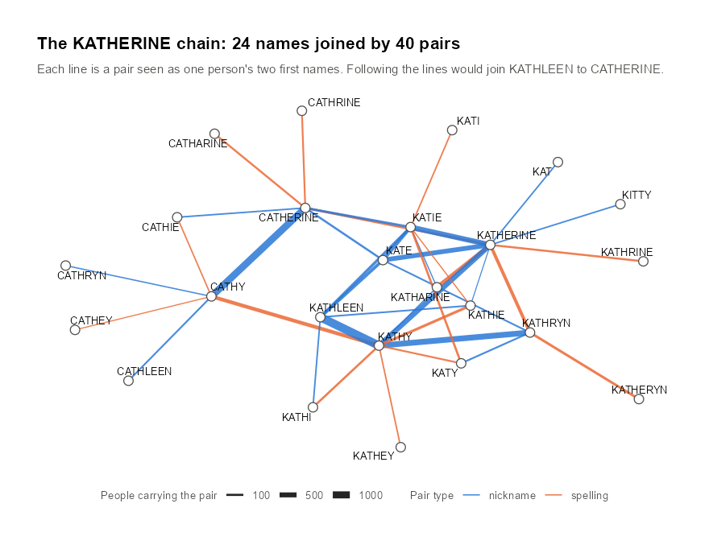
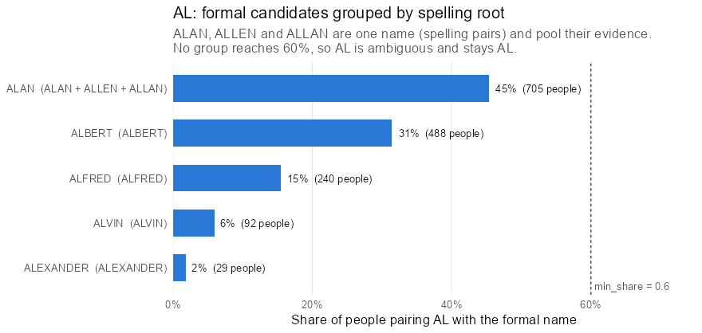
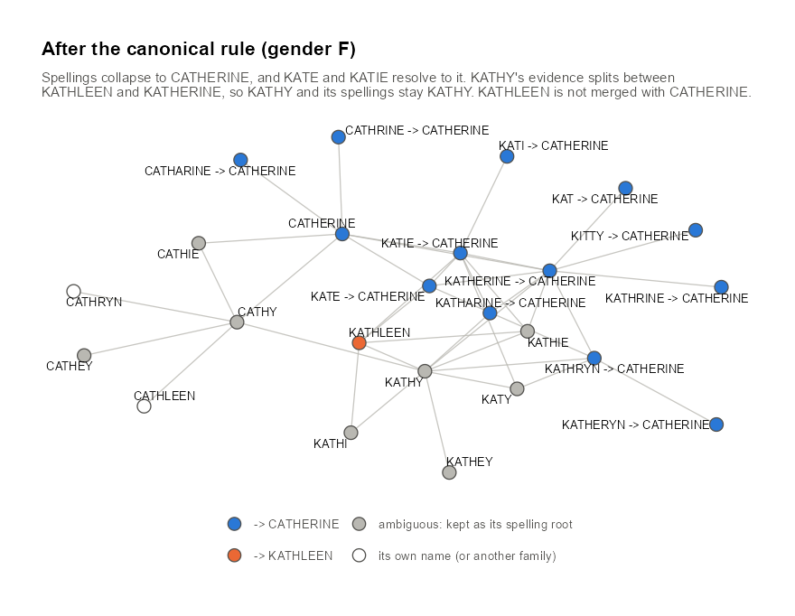
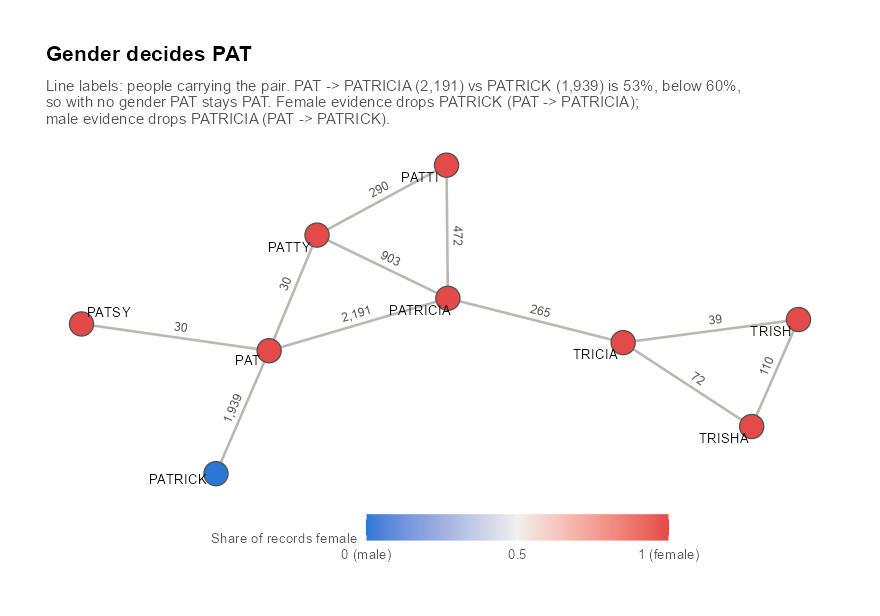

# Canonical first names, nicknames and gender

The same person often appears under different forms of their first name:
ROBERT one year, BOB the next, then ROBERT again. peopleparser can
attach to each parsed name its formal names, its nicknames, and one
**canonical first name**, a single form shared by the variants of a
name. This article explains where the variants come from, how the
canonical name is chosen when a name has several possible formal names,
and how gender is used to decide between them.

## The variant table

`first_name_pairs` holds pairs of first names that are two forms of one
given name. The pairs come from the **synthid** package. synthid follows
each person on a Form 990 Part VII list across their own organization’s
filings, 2010-2024 (15.0 million people), and records the first-name
forms each person used. A person listed as ROBERT, BOB and ROB gives
three pairs. The synthid vignette *First-name variants - how the table
was built* describes the build and the hand review.

``` r
table(first_name_pairs$type, first_name_pairs$lexicon)
#>              
#>               FALSE  TRUE
#>   cognate         0    29
#>   compound        0    20
#>   misspelling 10217     0
#>   nickname        0   397
#>   sound_alike 13748     0
#>   spelling        0   556
```

- The **lexicon** (`lexicon = TRUE`) is 1,002 pairs seen in 25 or more
  people, reviewed by hand: nicknames (BOB/ROBERT), spellings
  (STEVEN/STEPHEN), cognates (JOSE/JOSEPH) and compound names
  (MARY/MARYANN).
- The other rows were not reviewed. **Misspellings** pair a rare form
  with a common one (KATHRINE/CATHERINE). **Sound-alikes** pair two
  established names that sound the same (KRISTY/KRISTIE).

Each row records how many people carry the pair (`n_emp_ids`), how
common each form is nationally (`freq_short`, `freq_long`) and the share
of each form’s records that are female (`f_short`, `f_long`).

``` r
subset(first_name_pairs, name_short %in% c("PAT", "KATE") & lexicon,
       c(name_short, name_long, type, n_emp_ids, f_short, f_long, formal))
#> Key: <name_short>
#>     name_short name_long     type n_emp_ids f_short f_long formal
#>         <char>    <char>   <char>     <int>   <num>  <num> <char>
#>  1:       KATE KATHERINE nickname       456   0.997  0.999   long
#>  2:       KATE     KATIE nickname       246   0.997  0.999  short
#>  3:       KATE  KATHLEEN nickname       203   0.997  1.000   long
#>  4:       KATE CATHERINE nickname        92   0.997  0.999   long
#>  5:       KATE   KATHRYN nickname        63   0.997  0.999   long
#>  6:        PAT  PATRICIA nickname      2191   0.998  1.000   long
#>  7:        PAT   PATRICK nickname      1939   0.998  0.000   long
#>  8:        PAT     PATSY nickname        30   0.998  1.000   long
#>  9:        PAT     PATTY nickname        30   0.998  0.998  short
#> 10:        PAT      PATT spelling        26   0.998  0.000   <NA>
```

Pairs are stored with the shorter form first. That is not always the
formal name (JOHN/JOHNNY, DEBRA/DEBBIE), so the `formal` column says
which side of a nickname pair is the formal name. It comes from three
rules, in order:

1.  a pet ending added to the other form (JOHNNY, BILLY, KATIE from
    KATE);
2.  a pet ending (-Y, -IE, -EY, -I) on a form no longer than the other
    (KATHY/KATHLEEN, CHARLIE/CHARLES);
3.  otherwise, the longer form.

Three pairs were corrected by hand after review.

## Chains: why a name cannot simply follow its links

Each pair links two names, so the pairs form chains. In the KATHERINE
chain, 24 names are joined by 40 pairs:



Following the links would make every name in the chain one name. KATE is
a nickname of both KATHLEEN and CATHERINE, so KATHLEEN and CATHERINE
would be merged, although they are different names. The canonical rule
therefore uses only **direct** links: a spelling step, then at most one
nickname step.

## The canonical rule

### Step 1: spelling root

Spelling pairs (reviewed spellings, plus misspellings whose rare form
has fewer than 1,000 national records) form a graph. Each name moves to
its most common spelling partner, repeatedly, as long as that partner is
more common. Each step goes to a more common name, so the path always
ends. Its end is the **spelling root**:

``` r
nickname_lookup(c("KATHRYN", "KATHERINE", "STEVEN", "JEFFERY", "KATHRINE"))[
  , c("first_name_canonical", "canonical_rule")]
#>   first_name_canonical canonical_rule
#> 1            CATHERINE       spelling
#> 2            CATHERINE       spelling
#> 3              STEPHEN       spelling
#> 4              JEFFREY       spelling
#> 5            CATHERINE       spelling
```

KATHRYN moves to KATHERINE (more common), and KATHERINE to CATHERINE
(more common still). The 1,000-record cap keeps distinct names out:
MARCO is listed as a misspelling of MARK (8,069 records against
591,323), but it is a name in its own right, so it is not merged.

### Step 2: the nickname step

A name is resolved to a formal name when its spelling family is mainly
used as a nickname. Two tests decide this:

- more people carry the family as the nickname side of a pair than as
  the formal side; and
- the number of people carrying it as a nickname is at least
  `min_nick_rate` (0.2%) of the name’s national records.

The second test keeps standalone names standalone. Fifty people carry
MARK/MARCUS, out of 591,323 MARK records (0.008%), so MARK stays MARK.
JIM passes easily: 13,435 people carry JIM/JAMES, 3.7% of the JIM
records.

``` r
canonical_first_name(c("JIM", "MARK", "CHAD", "LISA"))
#> [1] "JAMES" "MARK"  "CHAD"  "LISA"
```

The formal candidates are the name’s **direct** formal partners.
Partners that are themselves mostly nicknames are dropped when any other
partner exists (KATIE is not resolved to KATE). The candidates are
grouped by spelling root, and each group is weighted by the people
carrying its pairs. The top group wins if it holds at least `min_share`
(60%) of the weight:



ALAN, ALLEN and ALLAN are one name, so they pool their evidence. Even
so, 45% is not enough, so AL is **ambiguous** and keeps its own spelling
root. KATHY is ambiguous for the same reason, split between KATHLEEN and
the KATHERINE spellings. Applied to the KATHERINE chain:



``` r
x <- c("KATE", "KATIE", "KITTY", "KATHY", "CATHY", "KATHLEEN", "CATHLEEN")
cbind(name = x, nickname_lookup(x, gender = "F", gender_confidence = 99)[
  , c("first_name_type", "first_name_canonical", "canonical_rule")])
#>       name first_name_type first_name_canonical canonical_rule
#> 1     KATE            both            CATHERINE       nickname
#> 2    KATIE        nickname            CATHERINE       nickname
#> 3    KITTY        nickname            CATHERINE       nickname
#> 4    KATHY        nickname                KATHY      ambiguous
#> 5    CATHY        nickname                KATHY      ambiguous
#> 6 KATHLEEN          formal             KATHLEEN           self
#> 7 CATHLEEN          formal             CATHLEEN           self
```

`canonical_rule` records how each canonical name was reached:

| rule | meaning |
|----|----|
| `self` | the name is its own canonical form |
| `spelling` | moved to its spelling root |
| `nickname` | resolved through the nickname step |
| `ambiguous` | a nickname whose formal name could not be chosen; kept as its spelling root |

## Gender

Gender is used only to choose among formal names. It does not change
spellings or the names in a family. The gender evidence for a record is:

1.  a gendered salutation: `MR` is male; `MRS`, `MS` and `MISS` are
    female;
2.  otherwise, the parsed `gender`, if `gender_confidence` is at least
    `min_confidence` (80);
3.  otherwise, unknown.

With known gender, formal candidates of the other gender are dropped. A
candidate’s gender is the majority of its national records (`f_long` or
`f_short`). Then the share test is applied to the candidates that
remain:



``` r
nickname_lookup(c("PAT", "PAT", "PAT"), gender = c("F", "M", "U"),
                gender_confidence = c(95, 95, 50))[
  , c("first_name_formal", "first_name_canonical", "canonical_rule")]
#>            first_name_formal first_name_canonical canonical_rule
#> 1           PATRICIA;; PATSY             PATRICIA       nickname
#> 2                    PATRICK              PATRICK       nickname
#> 3 PATRICIA;; PATRICK;; PATSY                  PAT      ambiguous
```

If gender rules out **every** candidate, the name keeps its own form
(`self`). The table has no female formal name for CHRIS, so a female
CHRIS stays CHRIS and is not sent to CHRISTOPHER:

``` r
nickname_lookup("CHRIS", gender = "F", gender_confidence = 95)[
  , c("first_name_formal", "first_name_canonical", "canonical_rule")]
#>         first_name_formal first_name_canonical canonical_rule
#> 1 CHRISTOPHER;; CHRISTIAN                CHRIS           self
```

**A caution about gender.** The `gender` field in a parse is itself
inferred from the first name (census name frequencies), and so is the
female share recorded in the variant table. 99.8% of PAT records in the
table are female. A parse of PAT says female with only 60% confidence.
That is below the threshold of 80, so PAT alone stays ambiguous. PAT
resolves to a formal name only when a salutation gives the gender. The
`gender` column of the parse does not use the salutation (MR PAT still
reads F there); the nickname step does:

``` r
parse_names(c("PAT SMITH", "MR PAT SMITH", "MRS PAT SMITH"), add_nicknames = TRUE)[
  , c("name", "gender", "gender_confidence", "first_name_canonical", "canonical_rule")]
#>            name gender gender_confidence first_name_canonical canonical_rule
#> 1     PAT SMITH      F              59.5                  PAT      ambiguous
#> 2  MR PAT SMITH      F              59.5              PATRICK       nickname
#> 3 MRS PAT SMITH      F              59.5             PATRICIA       nickname
```

## A name’s whole family: `first_name_variants()`

[`first_name_variants()`](https://nonprofit-open-data-collective.github.io/peopleparser/reference/first_name_variants.md)
lists everything that shares a name’s canonical form, and how each name
gets there. `via` is the name it connects through. Rows with
`in_canonical = FALSE` are related but **not** merged:

- unreviewed sound-alikes;
- cognates (JOSE for JOSEPH) and compounds (MARYANN);
- nicknames that are ambiguous between this name and another.

``` r
first_name_variants("kate", min_freq = 1000)
#>         name canonical           relation       via in_canonical   freq share_female
#> 1  CATHERINE CATHERINE          canonical                   TRUE  80652        0.999
#> 2  KATHERINE CATHERINE           spelling CATHERINE         TRUE  68778        0.999
#> 3    KATHRYN CATHERINE           spelling KATHERINE         TRUE  56874        0.999
#> 4  KATHARINE CATHERINE           spelling KATHERINE         TRUE   6640        0.990
#> 5       KATI CATHERINE           spelling     KATIE         TRUE   1936        0.998
#> 6  CATHARINE CATHERINE           spelling CATHERINE         TRUE   1624        0.978
#> 7   KATHERYN CATHERINE           spelling   KATHRYN         TRUE   1529        0.991
#> 8      KATIE CATHERINE           nickname KATHERINE         TRUE  83422        0.999
#> 9       KATE CATHERINE           nickname KATHERINE         TRUE  60703        0.997
#> 10     KITTY CATHERINE           nickname KATHERINE         TRUE   4930        0.997
#> 11       KAT CATHERINE           nickname KATHERINE         TRUE   2510        0.750
#> 12   KATRINA CATHERINE        sound_alike KATHERINE        FALSE  13742        0.999
#> 13     KATHI CATHERINE        sound_alike      KATE        FALSE   6391        0.990
#> 14   CATHRYN CATHERINE        sound_alike   CATHRIN        FALSE   2059        1.000
#> 15   CATRINA CATHERINE        sound_alike  CATERINA        FALSE   1067        1.000
#> 16     KATHY CATHERINE ambiguous nickname     KATHY        FALSE 170348        1.000
#> 17     CATHY CATHERINE ambiguous nickname     KATHY        FALSE  77965        0.999
#> 18      KATY CATHERINE ambiguous nickname     KATHY        FALSE  11867        0.993
#> 19    KATHIE CATHERINE ambiguous nickname     KATHY        FALSE   7323        0.997
#> 20    CATHIE CATHERINE ambiguous nickname     KATHY        FALSE   3165        0.996
```

KATE resolves to CATHERINE. The family holds CATHERINE’s spellings, the
misspellings that lead to them, and its nicknames. KATHY and CATHY
appear as ambiguous nicknames: they could belong to this family, but
they are not merged into it.

Without the related rows and the rare forms:

``` r
first_name_variants("steve", related = FALSE, min_freq = 100)
#>       name canonical    relation     via in_canonical   freq share_female
#> 1  STEPHEN   STEPHEN   canonical                 TRUE 218193        0.000
#> 2   STEVEN   STEPHEN    spelling STEPHEN         TRUE 204799        0.000
#> 3  STEPHAN   STEPHEN    spelling STEPHEN         TRUE   6925        0.000
#> 4 STEPHANE   STEPHEN misspelling STEPHEN         TRUE    806        0.998
#> 5   STEVAN   STEPHEN misspelling  STEVEN         TRUE    714        0.000
#> 6  STEPHON   STEPHEN misspelling STEPHEN         TRUE    237        0.000
#> 7    STEVI   STEPHEN misspelling   STEVE         TRUE    184        0.000
#> 8    STEVE   STEPHEN    nickname  STEVEN         TRUE 419562        0.000
```

Gender can change the family. For a female PAT the family is PATRICIA.
With no gender PAT is ambiguous, so its family is just PAT:

``` r
first_name_variants("pat", gender = "F", min_freq = 1000)
#>       name canonical  relation      via in_canonical   freq share_female
#> 1 PATRICIA  PATRICIA canonical                  TRUE 175659        1.000
#> 2    PATTI  PATRICIA  spelling    PATTY         TRUE  29761        0.998
#> 3   TRISHA  PATRICIA  spelling   TRICIA         TRUE   8246        0.997
#> 4   PATTIE  PATRICIA  spelling    PATTY         TRUE   2411        0.983
#> 5      PAT  PATRICIA  nickname PATRICIA         TRUE 110517        0.998
#> 6    PATTY  PATRICIA  nickname PATRICIA         TRUE  35193        0.998
#> 7   TRICIA  PATRICIA  nickname PATRICIA         TRUE  17703        0.996
#> 8  PATRICE  PATRICIA   cognate PATRICIA        FALSE   8788        0.998
first_name_variants("pat", min_freq = 1000)
#>     name canonical    relation via in_canonical   freq share_female
#> 1    PAT       PAT   canonical             TRUE 110517        0.998
#> 2  PATTI       PAT sound_alike PAT        FALSE  29761        0.998
#> 3 PATTIE       PAT sound_alike PAT        FALSE   2411        0.983
```

## Using it when parsing

[`parse_name()`](https://nonprofit-open-data-collective.github.io/peopleparser/reference/parse_name.md)
and
[`parse_names()`](https://nonprofit-open-data-collective.github.io/peopleparser/reference/parse_names.md)
take `add_nicknames = TRUE`, which adds the columns `first_name_type`,
`first_name_formal`, `first_name_nicknames`, `first_name_canonical` and
`canonical_rule`:

``` r
x <- c("Bob Jones", "MRS PAT LEE", "Kathy Ruiz", "STEVEN H PARK", "Mark Webb")
parse_names(x, add_nicknames = TRUE)[
  , c("name", "first_name", "gender", "first_name_formal", "first_name_canonical",
      "canonical_rule")]
#>            name first_name gender                          first_name_formal first_name_canonical
#> 1     Bob Jones        BOB      M                                     ROBERT               ROBERT
#> 2   MRS PAT LEE        PAT      F                           PATRICIA;; PATSY             PATRICIA
#> 3    Kathy Ruiz      KATHY      F KATHLEEN;; KATHRYN;; KATHERINE;; KATHARINE                KATHY
#> 4 STEVEN H PARK     STEVEN      M                                                         STEPHEN
#> 5     Mark Webb       MARK      M                                                            MARK
#>   canonical_rule
#> 1       nickname
#> 2       nickname
#> 3      ambiguous
#> 4       spelling
#> 5           self
```

The helpers
[`canonical_first_name()`](https://nonprofit-open-data-collective.github.io/peopleparser/reference/canonical_first_name.md),
[`get_formal_names()`](https://nonprofit-open-data-collective.github.io/peopleparser/reference/get_formal_names.md)
and
[`get_nicknames()`](https://nonprofit-open-data-collective.github.io/peopleparser/reference/get_nicknames.md)
return single columns of the same lookup.

## How well it works

A pilot on 33,535 Part VII records (1,000 organizations, 2010-2012) that
synthid had linked into persons compared the canonical name with
synthid’s earlier 70-name nickname table (`data-raw/pilot-nicknames/`):

|  | Same person, first names differ (204 pairs) | Different people, same return and year (per 1,000 pairs) |
|----|---:|---:|
| 70-name table, direct pairs | 56% matched | 2.2 |
| same canonical name | 83% matched | 2.9 |
| same canonical name, or a lexicon pair | 89% matched | 3.4 |

- For 93% of the people seen under both a nickname and its formal name,
  the two names get the same canonical name.
- About a quarter of records change name. 1.2% are ambiguous.
- Most same-person pairs still missed are typos (MARAGARET, STEPHEM),
  which a string-distance comparison handles.
- Most different-person “matches” are two people with one name on the
  same board (JIM and JAMES), which only the surname and other fields
  can separate.

The same-person figures are optimistic. The variant table was built from
the same kind of person links, so this test is partly circular. The
different-person test does not have that problem.

## Settings

| argument | default | effect |
|----|----|----|
| `min_share` | 0.6 | share of the evidence the top formal name needs; lower resolves more ambiguous nicknames |
| `min_nick_rate` | 0.002 | how much nickname use a name needs before it is resolved; 0 lets MARK resolve to MARCUS |
| `spelling` | `c("lexicon", "misspelling")` | add `"sound_alike"` to merge unreviewed sound-alikes too |
| `min_confidence` | 80 | census gender confidence needed to use `gender` |
